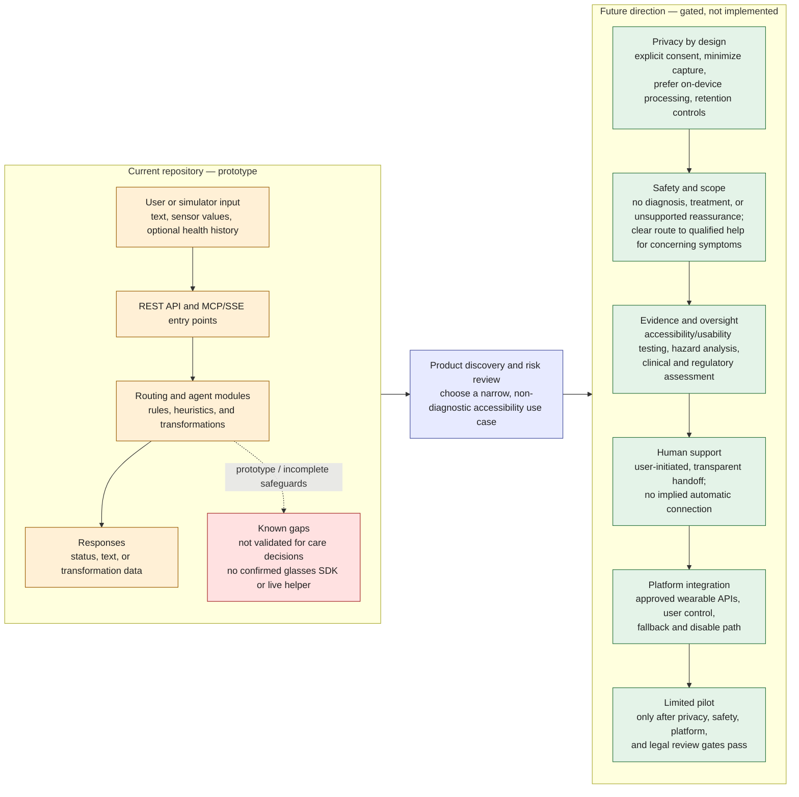
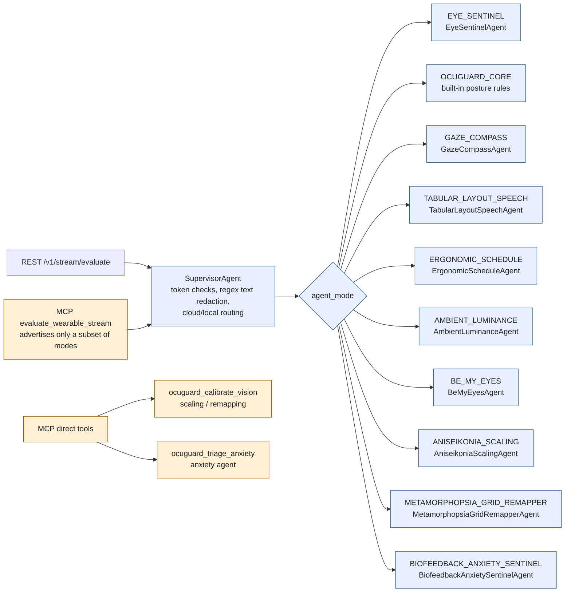

# OcuGuard: Current State to Future Product

> **Status:** The repository is a prototype. Agent names and behavior descriptions below are design intent, not evidence of clinical validation, regulatory clearance, production privacy controls, a live human-help service, or integration with Meta glasses or another manufacturer.
>
> This diagram is a product direction, not a promise that the future capabilities exist. A disclaimer alone does not establish that a product is non-medical or remove legal obligations.

## Agent catalog: implemented routes

The diagram distinguishes the shared REST routing path from direct MCP tools. These are repository capabilities, not proof of clinical effectiveness or production readiness.

### REST `agent_mode` values

| Mode | Implemented behavior |
|---|---|
| `EYE_SENTINEL` | Keyword-based symptom/positioning response path with local and cloud-backed branches. Not clinically validated. |
| `OCUGUARD_CORE` | Built-in pitch-threshold posture rules; this is a router branch, not a separate agent class. |
| `GAZE_COMPASS` | Computes low-vision alignment cues from target and blind-spot coordinates. |
| `TABULAR_LAYOUT_SPEECH` | Converts supplied text/layout content into a sequential audio-oriented outline. |
| `ERGONOMIC_SCHEDULE` | Evaluates posture-hold telemetry and returns wellness-oriented prompts. |
| `AMBIENT_LUMINANCE` | Evaluates supplied ambient-light and contrast values and returns display/environment suggestions. |
| `BE_MY_EYES` | Evaluates input through a local/cloud agent path. The repository does not establish that a live Be My Eyes connection is available. |
| `ANISEIKONIA_SCALING` | Produces a text scale factor and transformation matrix from supplied size-difference metrics. |
| `METAMORPHOPSIA_GRID_REMAPPER` | Produces a simplified warp matrix from a supplied waviness index. |
| `BIOFEEDBACK_ANXIETY_SENTINEL` | Matches transcript phrases and stress scores and returns reassurance text; not a clinical assessment. |

`SupervisorAgent` is the shared REST ingestion/routing component, not a selectable `agent_mode`. Its regex redaction and token checks must not be described as comprehensive PII protection, authentication, or regulatory compliance.

### Present in source, but not currently routed

`PreOpWaitlistAgent` exists in `agents/preop_waitlist.py`, but `app.py` has no corresponding `agent_mode` branch. The MCP schema advertises `PRE_OP_BRIDGE`, but the REST router does not implement that mode; unknown modes fall through to `EYE_SENTINEL`. Do not list the pre-op agent as a supported workflow until it is wired and tested. The MCP `evaluate_wearable_stream` schema also omits the three newer REST modes: `ANISEIKONIA_SCALING`, `METAMORPHOPSIA_GRID_REMAPPER`, and `BIOFEEDBACK_ANXIETY_SENTINEL`.

### Product and safety boundary

The agent behavior descriptions are not medical advice, validated safety guidance, or a substitute for a clinician. Do not claim a live human escalation service, comprehensive redaction, or wearable integration unless it has been implemented, tested, and explicitly enabled. In particular, do not provide diagnosis, treatment, or unsupported reassurance based on these prototype outputs.

## Testing strategy

### Decision

This project needs **both unit and integration tests**. The rule-based agents have safety-sensitive thresholds and calculations that should be verified without network access; the Flask REST API and FastAPI MCP/SSE server have separate contracts and routing behavior that need end-to-end handler tests. No database or message broker is currently part of the request path, so Docker-based infrastructure is not required for these tiers.

### Current test baseline and first action

The current test asset is `tests/test_triage_agent.py`. It covers a subset of agent logic and Flask behavior, but several API tests call legacy `/v1/triage*` URLs while the current application exposes `/v1/stream/*`. Reconcile those tests against the live routes and response fields before treating the suite as a baseline. The project manifest does not currently declare pytest as a test dependency; define a reproducible test dependency setup and a canonical command (`python -m pytest -q tests`) before relying on CI results.

### Unit test plan

Place focused tests under `tests/unit/` (or keep the current file structure until it is deliberately reorganized). Unit tests should use deterministic inputs, fixed timestamps, and mocks for external services; they must never call a real LLM, wearable, or human-help service.

| Area | Scenarios and assertions |
|---|---|
| `TelemetryFrame` and related schemas | Minimal valid payloads and defaults; malformed types; missing required fields; boundary and non-finite numeric values. Define and enforce acceptable ranges before asserting bounds. |
| `SupervisorAgent` | Email/phone/SSN redaction; text with multiple identifiers; missing, invalid, and valid tokens; `network_drop` routing; verify raw input is not included in logs or returned data. Redaction tests are not proof of complete de-identification. |
| `EyeSentinelAgent` | Emergency, urgent, routine, and unmatched phrases; exact pitch boundaries on either side of thresholds; post-op flag and timestamp boundaries; history factors; local fallback. Safety expectations must be clinician-reviewed before being treated as product requirements. |
| `OCUGUARD_CORE` posture rules | Values immediately below, at, and above each pitch threshold; unknown mode must be rejected rather than silently routed to a different behavior. |
| `GazeCompassAgent` | Target inside/on/outside blind-spot radius; zero and invalid radii; directional cases; ensure pan output is finite and within `[-1, 1]`. |
| `TabularLayoutSpeechAgent` | Empty text, plain paragraphs, small/large tables, irregular rows, and unsafe or malformed text; verify output preserves the input facts without inventing cell values. |
| `ErgonomicScheduleAgent` and `AmbientLuminanceAgent` | Threshold boundaries, missing/invalid telemetry, extreme values, and deterministic local behavior. |
| `BeMyEyesAgent` | Confidence immediately below/at/above its configured threshold; explicit user request and no-request cases; verify the agent never claims a live connection unless a real, consented handoff adapter reports success. |
| Calibration and reassurance agents | Positive/negative/extreme size deltas; waviness boundaries; matrix dimensions and finite values; stress-score boundaries; urgent distress phrases must not be answered with unsupported clinical reassurance. |
| OEM adapter contract | Feed synthetic vendor-shaped frames through an `OEMTelemetryAdapter` fake; verify field/unit normalization into `TelemetryFrame`, rejection of missing or malformed required fields, and that SDK-specific objects are not retained. |
| Error paths | Invalid payloads and simulated downstream exceptions must produce an explicit non-success outcome, not a `SAFE` fallback or success-shaped response. |

### Integration test plan

Use framework-native in-process clients: Flask's `app.test_client()` for REST and FastAPI's `TestClient` for MCP HTTP handlers. Stub external LLM/API calls at the boundary and assert that tests make no outbound network requests. There is no persistent store to seed or clean up; reset in-memory rate-limit/statistics state for each test. Test the actual registered handlers rather than only calling routing functions directly.

| Flow | Integration scenarios and acceptance criteria |
|---|---|
| REST health/info | `/health` and `/v1/stream/info` return documented status and supported modes; the published mode list matches the router exactly. |
| REST single-frame evaluation | Valid minimal frame for every implemented `agent_mode` returns the documented response schema; invalid/missing fields return a clear 4xx; unsupported modes are rejected and never fall through to `EYE_SENTINEL`. |
| REST privacy and auth | With API key protection enabled, protected config/stats reject missing and incorrect keys and accept the configured key. Evaluate requests redact supported identifiers before downstream use; verify no raw transcript/identifier appears in captured logs. Test API-key-disabled behavior separately and document it as development-only. |
| REST batch evaluation | Empty/malformed batches, sizes 1/10/11, mixed valid/invalid entries, and partial failures. The response must preserve each input index and must not report a failed item as successful. |
| Rate limiting | Requests at the configured limit succeed; the next request returns 429; expiry/reset behavior is deterministic. Use an isolated client identity and reset shared state after each test. |
| MCP discovery and initialization | Initialize and `tools/list` responses are valid JSON-RPC and consistent with implemented tools, required fields, and supported modes. Ensure the registered server and stateless compatibility routes do not publish divergent tool schemas. |
| MCP tool calls | Exercise `evaluate_wearable_stream`, `ocuguard_calibrate_vision`, and `ocuguard_triage_anxiety` through the transport handler. Results include required structured status and transformation fields; malformed arguments and agent failures are explicit protocol/tool errors, not ordinary success text. |
| Cross-transport contract | For modes available over both REST and MCP, compare accepted inputs and response meaning. Verify the three newer REST modes are either added to the MCP schema or clearly documented as REST-only; do not advertise unrouted `PRE_OP_BRIDGE` as supported. |
| OEM adapter boundary | Use a fake vendor adapter with synthetic events to verify adapter output matches `TelemetryFrame`, required permissions/consent are handled by the integration layer, and disconnect/malformed-frame behavior fails explicitly without requiring physical hardware. |
| Resilience and data handling | Simulated LLM outage uses only the documented deterministic fallback; requests containing identifying text do not leak through response, logs, or exception messages. No test may trigger an actual human-service connection. |

### Execution and release gates

- Canonical local/CI command: `pytest -q`; unit and integration suites must both be included.
- Keep unit tests offline and fast. Integration tests use in-process clients and mocked external services; no Docker is needed unless a real external dependency is added later.
- Require deterministic tests for every supported mode and explicit error-path assertions. Run the suite in CI for each change to schemas, routes, agents, or MCP tool definitions.
- A passing test suite establishes software behavior only. It does not establish clinical safety, accessibility effectiveness, privacy-law compliance, regulatory classification, or legal-liability protection. Those require separate expert review and validation before any patient-facing pilot.
