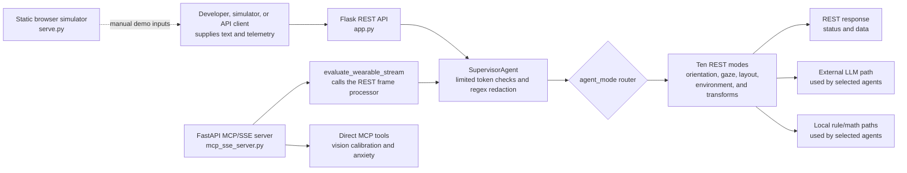
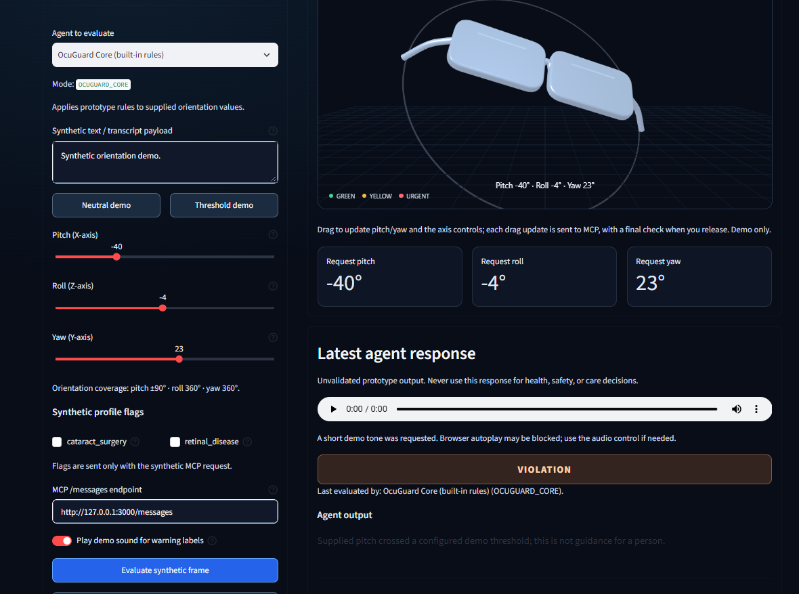
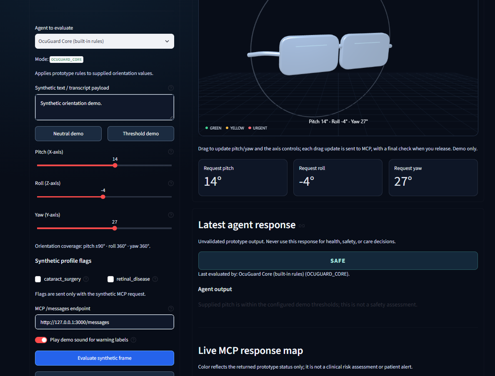
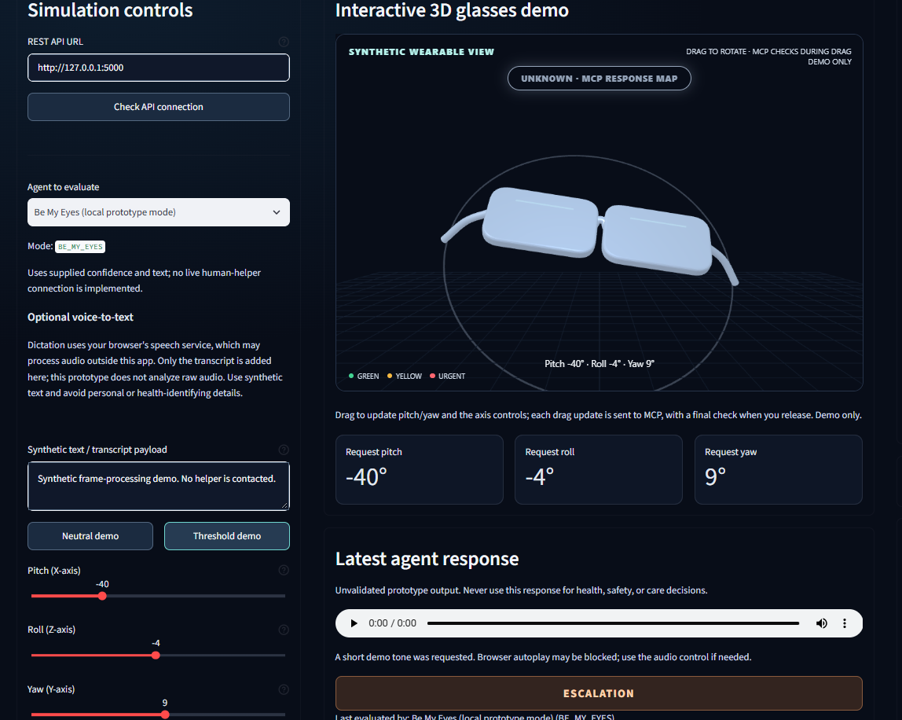

# OcuGuard: Recovery-Support Exploration

OcuGuard is an open-source project exploring how accessible, user-controlled software might help people use recovery instructions already provided by their care team and access optional encouragement. The long-term idea may include approved wearable devices as an interface, but the current repository is a software prototype, not a recovery product.

**Status: prototype/demo only.** This repository does not currently integrate with Meta glasses or another manufacturer SDK, capture camera or microphone streams from a wearable, render output on eyewear, or establish a live human-helper connection. Inputs are supplied to its APIs or simulator; do not describe the project as an operational wearable product.

---

## Purpose and scope

### Why the project exists

The idea was motivated by a anonymous person's experience after retinal-detachment surgery: their doctor gave them a specific instruction about limiting head movement. That personal story points to a possible support problem - remembering and living with care-team instructions can be difficult - but it is not a universal recovery protocol. Instructions vary by procedure and person; only the treating care team can set or change them.

### Proposed long-term purpose

> **OcuGuard explores a patient-controlled recovery companion that makes care-team instructions easier to access and remember, while offering optional, non-clinical encouragement. It does not create, interpret, change, or replace medical instructions.**

The first research scope should be narrow: people who have received a specific recovery instruction from their own care team and want help accessing that instruction. Do not frame OcuGuard as an app for "anyone struggling" until separate user needs, risks, and intended uses have been studied.

The safest first product hypothesis is **non-sensing**: let a person view an instruction they already received, choose whether and when to receive a reminder, and optionally see a supportive message. A future OEM device could provide an approved display or input surface. Sensor-based posture monitoring or feedback is a later, separate research question; a device reading must never be treated as proof that a person is following instructions or is medically safe.

### What "agentic" should mean here

If agentic features are developed later, agents should coordinate a user-approved plan, not make care decisions:

| Future role concept | Appropriate boundary |
|---|---|
| Instruction presenter | Show clinician-authored content faithfully; never invent or revise a position or movement restriction. |
| Reminder coordinator | Let the user choose, pause, snooze, or stop reminders. A missed acknowledgment is not a clinical finding. |
| Encouragement companion | Offer optional, reviewed, non-clinical messages. Do not claim to provide therapy, assess emotions, or reassure someone that a symptom is safe. |
| Wearable adapter | Handle supported device connection, permissions, signal availability, and output capabilities; it is not a clinical authority. |
| Human-support option | Offer a user-selected contact path only with clear consent and confirmation; do not imply an automatic clinician or helper connection. |

The ten REST modes in this repository are experiments, not this recovery workflow. Their names and current behavior do not establish that these future roles exist or are safe.

### What the repository does today

The code currently provides a Flask REST API, a FastAPI MCP/SSE server, a browser/Streamlit simulator, and prototype agent modes that process caller-supplied text or numeric values. It has no care-plan management, patient reminders, reviewed encouragement library, live wearable connection, or evidence that its outputs improve recovery.

Do not use the current software to decide or remind a person how to position after surgery. It is for synthetic-data development and demonstration only. Any real instructions, sensor feedback, emotional-support feature, or patient-facing use would require separate design, implementation, accessibility and safety testing, and qualified clinical, privacy, security, legal, and regulatory review. No wording or disclaimer can guarantee freedom from liability.

---

## Current Architecture and Data Flow

The system orchestrates stream data across an extensible, decoupled plugin architecture:



The diagram describes code paths, not safety certification or real-time sensor integration. Some agents use external model calls; others use local rules or calculations. Do not assume every mode is offline or that all failures have a safe fallback.

## Sample screenshots

### Unsafe Head Movement detected


### Safe Head Movement 


### Be My Eyes escalation


### Agent modules
1. Supervisor Agent (`SupervisorAgent`): Shared REST ingestion and routing code. It performs limited token checks and regex redaction; it is not comprehensive privacy protection or an authentication layer.

2. Eye Sentinel Agent (`EyeSentinelAgent`): Keyword-based symptom and positioning response path with local and cloud-backed branches; not clinically validated.

3. Gaze Compass Agent (`GazeCompassAgent`): Computes low-vision alignment cues from supplied target and blind-spot coordinates; it does not track objects from a glasses camera.

4. Tabular Layout Speech Agent (`TabularLayoutSpeechAgent`): Converts supplied text/layout content into an audio-oriented outline; it does not capture OCR from a wearable.

5. Ergonomic Schedule Agent (`ErgonomicScheduleAgent`): Evaluates supplied posture-hold telemetry and returns wellness-oriented prompts.

6. Ambient Luminance Agent (`AmbientLuminanceAgent`): Evaluates supplied ambient-light and contrast values and returns suggestions; no lens tint integration is present.

7. Be My Eyes Agent (`BeMyEyesAgent`): Evaluates input through a local/cloud agent path. A live Be My Eyes connection is not implemented here.

8. **Aniseikonia Scaling Agent**: Produces a text scale factor and transformation matrix from supplied size-difference metrics.

9. **Metamorphopsia Grid Remapper Agent**: Produces a simplified warp matrix from a supplied waviness index.

10. **Biofeedback Anxiety Sentinel Agent**: Matches transcript phrases and stress scores and returns reassurance text; it is not a clinical assessment.

The descriptions above summarize code modules, not connected hardware features. In particular, Gaze Compass works from coordinates supplied in telemetry; it does not continuously track objects from a glasses camera.

The REST router currently recognizes these ten `agent_mode` values: `EYE_SENTINEL`, `OCUGUARD_CORE`, `GAZE_COMPASS`, `TABULAR_LAYOUT_SPEECH`, `ERGONOMIC_SCHEDULE`, `AMBIENT_LUMINANCE`, `BE_MY_EYES`, `ANISEIKONIA_SCALING`, `METAMORPHOPSIA_GRID_REMAPPER`, and `BIOFEEDBACK_ANXIETY_SENTINEL`. `SupervisorAgent` is a shared routing component, not a mode. `PreOpWaitlistAgent` is present in source but is not routed; `PRE_OP_BRIDGE` is advertised by the MCP schema but is not implemented by the REST router. The MCP mode enum omits the three newer REST modes.

### Safety, Privacy, and Intended Use
This project is a software prototype. This README does not determine the product's regulatory classification.

Do not use the software for diagnosis, triage, treatment, emergency response, or post-operative positioning, or to make care decisions or delay contacting a qualified clinician or emergency service.

The API accepts health-related content. This repository does not establish production-grade consent, authentication, encryption, retention, or privacy controls. Do not send real patient data or identifiable transcripts to a demo deployment.

A disclaimer or open-source license does not determine regulatory status or eliminate legal obligations. Obtain jurisdiction-specific clinical, privacy, security, and regulatory review before any patient-facing use. No Meta, Apple, Google, or Be My Eyes partnership or endorsement is implied.

## Quick start

### Static simulator

The browser simulator serves local static files. It does not connect to smart glasses or capture camera/microphone streams.

1. Clone this repository and navigate to the project directory.

2. Spin up the localized application daemon:
```bash
python serve.py
```

3. Open [http://localhost:8000/index.html](http://localhost:8000/index.html) to try the simulated controls.

### Streamlit developer console

For an interactive, API-connected demo UI, install the optional dependencies:

```bash
python -m pip install -r requirements-ui.txt
```

Start the REST API in one terminal:

```bash
python app.py
```

Start OcuGuard Studio in a second terminal:

```bash
python -m streamlit run ui/streamlit_app.py
```

Open the local URL printed by Streamlit (normally [http://localhost:8501](http://localhost:8501)). The console sends synthetic frames to the Flask API at `http://127.0.0.1:5000` by default; change the API URL in the controls panel if needed. Pitch, roll, and yaw sliders update the illustrative glasses scene. Dragging the glasses locally shows green/red for the OcuGuard Core demo threshold; it does not change the API values. The dashboard identifies the selected agent and offers a catalog of all ten prototype modes and their input-based strengths. After you submit a frame, the selected agent's response and measured API round-trip time appear. An optional demo tone can play for selected warning-like API labels. This is not a live wearable alert. See the [Streamlit UI guide](ui/README.md) for details.

### Start the APIs

Use Python 3.10 or newer. Install dependencies:

```bash
python -m pip install -r requirements.txt
```

Optionally copy `.env.example` to `.env` and configure the required credentials for any external integrations. Never commit secrets.

Start each server in a separate terminal:

```bash
# REST API at http://localhost:5000
python app.py
```

```bash
# MCP/SSE server at http://localhost:3000
python mcp_sse_server.py
```

Both servers bind to all interfaces by default. Keep them on a trusted development environment; do not expose them publicly as-is.

### Running Automated Test Suites
The existing test module is a starting point, not a verified release baseline. Some API tests reference older `/v1/triage*` routes, while the current Flask app exposes `/v1/stream/*`; reconcile those tests before relying on their results. Pytest is not currently declared in the project dependencies.

```bash
python -m pip install pytest
python -m pytest -q tests
```

See the [unit and integration test strategy](AGENTS.md#testing-strategy) for the planned coverage and known gaps.

## Repository layout

```text
agents/                 Agent implementations
core/                   Shared schemas and plugin interfaces
docs/                   Specification, contributor guide, architecture
integrations/oem/        OEM adapter contract and synthetic Meta-shaped example only
tests/                  Unit and API tests
ui/                     Optional Streamlit developer console
app.py                  Flask REST entry point
mcp_sse_server.py       MCP/SSE entry point
mcp_agent_server.py     MCP stdio entry point
serve.py                Static simulator
```

Future manufacturer-specific adapters belong under `integrations/oem/`. The vendor-neutral `OEMTelemetryAdapter` contract maps SDK frames into `core.schemas.TelemetryFrame`; it does not implement or imply a Meta or other OEM integration. See the [OEM integration notes](integrations/oem/README.md), [architecture guide](docs/architecture.md), and [wearable integration action plan](docs/wearable-integration-action-plan.md).

## API overview

### Flask REST API

| Route | Purpose |
|---|---|
| `GET /health` | Basic process health response. |
| `GET /v1/stream/info` | Service metadata and a supported-agent list; the current list omits newer routed modes, so consult the mode list below. |
| `POST /v1/stream/evaluate` | Validates and routes a single telemetry frame. |
| `POST /v1/stream/evaluate/batch` | Evaluates up to 10 frames. |
| `GET /v1/system/config` | Configuration endpoint protected by `X-API-Key` when `API_KEY` is configured. |
| `GET /v1/system/stats` | Aggregate statistics endpoint protected by `X-API-Key` when `API_KEY` is configured. |

`POST /v1/stream/evaluate` requires `user_id` and `input_string`; `agent_mode` defaults to `EYE_SENTINEL`. The ten implemented modes are `EYE_SENTINEL`, `OCUGUARD_CORE`, `GAZE_COMPASS`, `TABULAR_LAYOUT_SPEECH`, `ERGONOMIC_SCHEDULE`, `AMBIENT_LUMINANCE`, `BE_MY_EYES`, `ANISEIKONIA_SCALING`, `METAMORPHOPSIA_GRID_REMAPPER`, and `BIOFEEDBACK_ANXIETY_SENTINEL`.

### MCP tools

| Tool | Inputs | Current limitation |
|---|---|---|
| `evaluate_wearable_stream` | Frame fields including `user_id`, `input_string`, `agent_mode`, `pitch`, and `yaw`. | MCP schema's mode enum is incomplete: it advertises `PRE_OP_BRIDGE` but omits three REST modes. |
| `ocuguard_calibrate_vision` | `visual_field_clearance`, `perceived_size_delta`, `text_wavy_index`. | The schema requires both calibration metrics, but the handler chooses one agent based on the presence of `perceived_size_delta`; the remapping branch is therefore not reachable with a schema-valid call. The handler currently returns text, not the documented structured transform payload. |
| `ocuguard_triage_anxiety` | `input_string`, `vocal_stress_score`. | Returns plain text status/reassurance; it is not medical triage or a clinical assessment. |

The MCP handlers currently format results as text rather than returning a typed structured payload. Validate the server's discovery and session behavior against the MCP clients you intend to support; the stateless compatibility routes do not implement every MCP method.

---

## Request paths and limitations

1. **Flask REST (`app.py`):** `/v1/stream/evaluate` validates the frame, passes it through `SupervisorAgent`, and selects a handler by `agent_mode`. Some modes use an external LLM path; behavior depends on the selected agent and fallback.
2. **MCP/SSE (`mcp_sse_server.py`):** `evaluate_wearable_stream` calls the REST frame processor. The two direct tools call their agent modules directly and bypass the REST supervisor path. The current implementation returns text content from tool calls, not the structured payload described by some older docs.
3. **MCP stdio (`mcp_agent_server.py`):** Provides a separate stdio transport for MCP clients.
4. **Static simulator (`serve.py`):** Serves the local browser files. It does not provide a glasses SDK or itself stream sensor data to either API.

These are separate processes. Do not assume network failures always fall back locally, that all calls are stateless, or that API/MCP results are suitable for patient care.

---

## Contributing
Contributions are welcome. Keep pull requests aligned with the prototype's documented scope, avoid implying clinical or hardware capabilities that are not implemented, and include tests for behavior changes.

### How to help
- Test coverage: Add deterministic unit tests and REST/MCP integration tests; see [AGENTS.md](AGENTS.md#testing-strategy).
- Simulator: Improve the browser demo and clearly label simulated data and limitations.
- Integrations: Propose device or audio integrations only against a documented, approved platform API, with user consent and a safe disable path.

Open an issue or discussion to propose a change.
