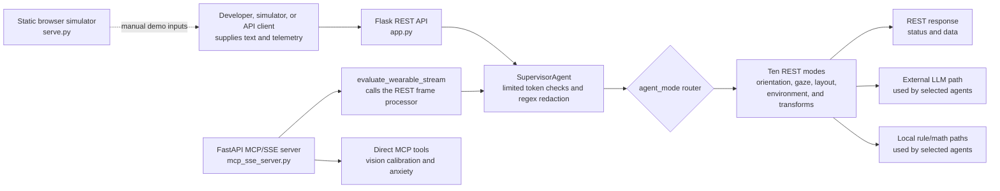

# OcuGuard: Smart-Eyewear Accessibility Prototype

OcuGuard is an open-source prototype for processing user-supplied text and telemetry and returning accessibility-oriented cues. It contains a Flask REST API, a FastAPI MCP/SSE server, a browser-based simulator, and agent modules for visual layout, orientation, and environment experiments.

**Status: prototype/demo only.** This repository does not currently integrate with Meta glasses or another manufacturer SDK, capture camera or microphone streams from a wearable, render output on eyewear, or establish a live human-helper connection. Inputs are supplied to its APIs or simulator; do not describe the project as an operational wearable product.

---

## Purpose and scope

The project explores how user-supplied visual and orientation metrics might be transformed into accessible text, layout, and environmental cues. It is an engineering prototype intended for simulation and experimentation, not a validated solution for post-operative recovery or other medical needs.

The current repository does not establish a connection to live wearable sensors or prove that its outputs improve safety, accessibility, or productivity. Hardware integration and any patient-facing use would require separate implementation, testing, and expert review.

---

## Current Architecture and Data Flow

The system orchestrates stream data across an extensible, decoupled plugin architecture:



The diagram describes code paths, not safety certification or real-time sensor integration. Some agents use external model calls; others use local rules or calculations. Do not assume every mode is offline or that all failures have a safe fallback.

### Agent modules
1. Supervisor Agent (`SupervisorAgent`): Shared REST ingestion and routing code. It performs limited token checks and regex redaction; it is not comprehensive privacy protection or an authentication layer.

2. Eye Sentinel Agent (`EyeSentinelAgent`): Keyword-based symptom and positioning response path with local and cloud-backed branches; not clinically validated.

3. Gaze Compass Agent (`GazeCompassAgent`): Computes low-vision alignment cues from supplied target and blind-spot coordinates; it does not track objects from a glasses camera.

4. Tabular Layout Speech Agent (`TabularLayoutSpeechAgent`): Converts supplied text/layout content into an audio-oriented outline; it does not capture OCR from a wearable.

5. Ergonomic Schedule Agent (`ErgonomicScheduleAgent`): Evaluates supplied posture-hold telemetry and returns wellness-oriented prompts.

6. Ambient Luminance Agent (`AmbientLuminanceAgent`): Evaluates supplied ambient-light and contrast values and returns suggestions; no lens tint integration is present.

7. Be My Eyes Agent (`BeMyEyesAgent`): Evaluates input through a local/cloud agent path. A live Be My Eyes connection is not implemented here.

8. **Aniseikonia Scaling Agent**: Produces a text scale factor and transformation matrix from supplied size-difference metrics.

9. **Metamorphopsia Grid Remapper Agent**: Produces a simplified warp matrix from a supplied waviness index.

10. **Biofeedback Anxiety Sentinel Agent**: Matches transcript phrases and stress scores and returns reassurance text; it is not a clinical assessment.

The descriptions above summarize code modules, not connected hardware features. In particular, Gaze Compass works from coordinates supplied in telemetry; it does not continuously track objects from a glasses camera.

The REST router currently recognizes these ten `agent_mode` values: `EYE_SENTINEL`, `OCUGUARD_CORE`, `GAZE_COMPASS`, `TABULAR_LAYOUT_SPEECH`, `ERGONOMIC_SCHEDULE`, `AMBIENT_LUMINANCE`, `BE_MY_EYES`, `ANISEIKONIA_SCALING`, `METAMORPHOPSIA_GRID_REMAPPER`, and `BIOFEEDBACK_ANXIETY_SENTINEL`. `SupervisorAgent` is a shared routing component, not a mode. `PreOpWaitlistAgent` is present in source but is not routed; `PRE_OP_BRIDGE` is advertised by the MCP schema but is not implemented by the REST router. The MCP mode enum omits the three newer REST modes.

### Safety, Privacy, and Intended Use
This project is a software prototype. This README does not determine the product's regulatory classification.

Do not use the software for diagnosis, triage, treatment, emergency response, or post-operative positioning, or to make care decisions or delay contacting a qualified clinician or emergency service.

The API accepts health-related content. This repository does not establish production-grade consent, authentication, encryption, retention, or privacy controls. Do not send real patient data or identifiable transcripts to a demo deployment.

A disclaimer or open-source license does not determine regulatory status or eliminate legal obligations. Obtain jurisdiction-specific clinical, privacy, security, and regulatory review before any patient-facing use. No Meta, Apple, Google, or Be My Eyes partnership or endorsement is implied.

## Quick start

### Static simulator

The browser simulator serves local static files. It does not connect to smart glasses or capture camera/microphone streams.

1. Clone this repository and navigate to the project directory.

2. Spin up the localized application daemon:
```bash
python serve.py
```

3. Open [http://localhost:8000/index.html](http://localhost:8000/index.html) to try the simulated controls.

### Start the APIs

Use Python 3.10 or newer. Install dependencies:

```bash
python -m pip install -r requirements.txt
```

Optionally copy `.env.example` to `.env` and configure the required credentials for any external integrations. Never commit secrets.

Start each server in a separate terminal:

```bash
# REST API at http://localhost:5000
python app.py
```

```bash
# MCP/SSE server at http://localhost:3000
python mcp_sse_server.py
```

Both servers bind to all interfaces by default. Keep them on a trusted development environment; do not expose them publicly as-is.

### Running Automated Test Suites
The existing test module is a starting point, not a verified release baseline. Some API tests reference older `/v1/triage*` routes, while the current Flask app exposes `/v1/stream/*`; reconcile those tests before relying on their results. Pytest is not currently declared in the project dependencies.

```bash
python -m pip install pytest
python -m pytest -q tests
```

See the [unit and integration test strategy](AGENTS.md#testing-strategy) for the planned coverage and known gaps.

## Repository layout

```text
agents/                 Agent implementations
core/                   Shared schemas and plugin interfaces
docs/                   Specification, contributor guide, architecture
integrations/oem/        OEM adapter contract; no vendor SDK adapters yet
tests/                  Unit and API tests
app.py                  Flask REST entry point
mcp_sse_server.py       MCP/SSE entry point
mcp_agent_server.py     MCP stdio entry point
serve.py                Static simulator
```

Future manufacturer-specific adapters belong under `integrations/oem/`. The vendor-neutral `OEMTelemetryAdapter` contract maps SDK frames into `core.schemas.TelemetryFrame`; it does not implement or imply a Meta or other OEM integration. See the [OEM integration notes](integrations/oem/README.md) and [architecture guide](docs/architecture.md).

## API overview

### Flask REST API

| Route | Purpose |
|---|---|
| `GET /health` | Basic process health response. |
| `GET /v1/stream/info` | Service metadata and a supported-agent list; the current list omits newer routed modes, so consult the mode list below. |
| `POST /v1/stream/evaluate` | Validates and routes a single telemetry frame. |
| `POST /v1/stream/evaluate/batch` | Evaluates up to 10 frames. |
| `GET /v1/system/config` | Configuration endpoint protected by `X-API-Key` when `API_KEY` is configured. |
| `GET /v1/system/stats` | Aggregate statistics endpoint protected by `X-API-Key` when `API_KEY` is configured. |

`POST /v1/stream/evaluate` requires `user_id` and `input_string`; `agent_mode` defaults to `EYE_SENTINEL`. The ten implemented modes are `EYE_SENTINEL`, `OCUGUARD_CORE`, `GAZE_COMPASS`, `TABULAR_LAYOUT_SPEECH`, `ERGONOMIC_SCHEDULE`, `AMBIENT_LUMINANCE`, `BE_MY_EYES`, `ANISEIKONIA_SCALING`, `METAMORPHOPSIA_GRID_REMAPPER`, and `BIOFEEDBACK_ANXIETY_SENTINEL`.

### MCP tools

| Tool | Inputs | Current limitation |
|---|---|---|
| `evaluate_wearable_stream` | Frame fields including `user_id`, `input_string`, `agent_mode`, `pitch`, and `yaw`. | MCP schema's mode enum is incomplete: it advertises `PRE_OP_BRIDGE` but omits three REST modes. |
| `ocuguard_calibrate_vision` | `visual_field_clearance`, `perceived_size_delta`, `text_wavy_index`. | The schema requires both calibration metrics, but the handler chooses one agent based on the presence of `perceived_size_delta`; the remapping branch is therefore not reachable with a schema-valid call. The handler currently returns text, not the documented structured transform payload. |
| `ocuguard_triage_anxiety` | `input_string`, `vocal_stress_score`. | Returns plain text status/reassurance; it is not medical triage or a clinical assessment. |

The MCP handlers currently format results as text rather than returning a typed structured payload. Validate the server's discovery and session behavior against the MCP clients you intend to support; the stateless compatibility routes do not implement every MCP method.

---

## Request paths and limitations

1. **Flask REST (`app.py`):** `/v1/stream/evaluate` validates the frame, passes it through `SupervisorAgent`, and selects a handler by `agent_mode`. Some modes use an external LLM path; behavior depends on the selected agent and fallback.
2. **MCP/SSE (`mcp_sse_server.py`):** `evaluate_wearable_stream` calls the REST frame processor. The two direct tools call their agent modules directly and bypass the REST supervisor path. The current implementation returns text content from tool calls, not the structured payload described by some older docs.
3. **MCP stdio (`mcp_agent_server.py`):** Provides a separate stdio transport for MCP clients.
4. **Static simulator (`serve.py`):** Serves the local browser files. It does not provide a glasses SDK or itself stream sensor data to either API.

These are separate processes. Do not assume network failures always fall back locally, that all calls are stateless, or that API/MCP results are suitable for patient care.

---

## Contributing
Contributions are welcome. Keep pull requests aligned with the prototype's documented scope, avoid implying clinical or hardware capabilities that are not implemented, and include tests for behavior changes.

### How to help
- Test coverage: Add deterministic unit tests and REST/MCP integration tests; see [AGENTS.md](AGENTS.md#testing-strategy).
- Simulator: Improve the browser demo and clearly label simulated data and limitations.
- Integrations: Propose device or audio integrations only against a documented, approved platform API, with user consent and a safe disable path.

Open an issue or discussion to propose a change.
