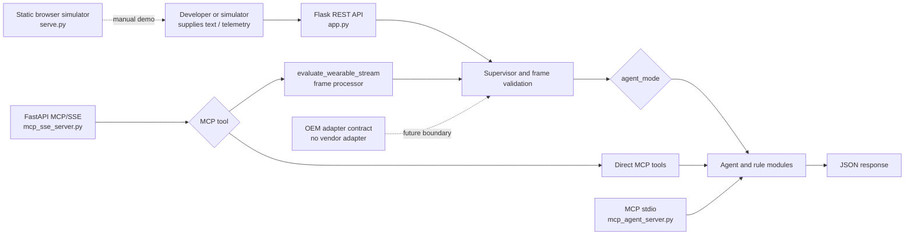
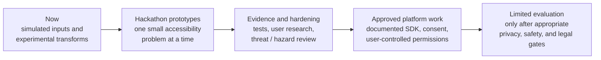

# OcuGuard Product and Engineering Brief

> **Project status: open-source prototype.** OcuGuard explores ways to make user-supplied text and simulated telemetry easier to work with through accessible, software-generated cues. It is not a validated assistive device or healthcare product.
>
> This document separates what the repository does today from ideas that would need design, evidence, and review before becoming a product. Names used by existing code are not claims about clinical capability.

[Start here](../README.md) · [Contributing and hackathon guide](./contributing.md) · [Architecture](./architecture.md) · [Wearable action plan](./wearable-integration-action-plan.md)

## Origin and proposed purpose

The project was prompted by a friend's personal experience after retinal-detachment surgery: their doctor gave them a specific instruction about limiting head movement. This is a useful reason to explore recovery support, not a universal rule. Post-surgical instructions depend on the procedure and the individual; the treating care team is the source of truth.

> **Proposed north star:** Explore a patient-controlled recovery companion that makes care-team instructions easier to access and remember, while offering optional, non-clinical encouragement. OcuGuard must not create, interpret, change, or replace medical instructions.

The first research scope should be a clearly defined group with a specific care-team-provided instruction, not "anyone struggling." Start with a non-sensing concept: faithfully present the person's existing instruction, let them choose reminders, and offer optional supportive messages. A future OEM device might provide an approved display or input surface. Sensor-based posture monitoring or feedback requires a separate feasibility, safety, and evidence review.

## The opportunity

People may find it difficult to access instructions or stay emotionally supported during recovery, especially when temporary vision changes or device accessibility needs are involved. OcuGuard can explore user-controlled ways to present information and reminders, while involving people with lived experience and appropriate care professionals in deciding whether those features are useful.

The current repository is a software sandbox: inputs are supplied by a caller or simulator. It does not read glasses cameras, connect to a manufacturer SDK, manage a clinician-authored recovery plan, send patient reminders, or provide reviewed emotional support. It does not prove that any cue is effective or safe.

## Product principles

1. **User agency:** A person should be able to inspect, adjust, pause, and turn off an experience.
2. **Accessibility first:** Make content more perceivable and operable; include people with different access needs in design and testing.
3. **Be clear about uncertainty:** Show the source and limits of an output. A heuristic or model response is not a verified fact.
4. **Minimize data:** Prefer synthetic examples, collect only what a feature needs, and make external data flows visible.
5. **Graceful failure:** Explain unavailable or invalid results. Do not silently convert errors into reassuring or safety-critical guidance.
6. **No generated care instructions:** The prototype is not a diagnostic, treatment, emergency, or post-operative guidance system. A future reminder feature may only present content supplied or confirmed by the user's care team; an agent must never invent or modify a restriction.

## Bounded agent roles for a future recovery companion

The word "agentic" should mean coordinating a user-approved experience, not delegating care decisions to autonomous software.

| Proposed role | Allowed responsibility | Not allowed |
|---|---|---|
| Instruction presenter | Display the approved instruction, its source, and any user-confirmed schedule. | Interpret a procedure, generate positioning advice, or silently rewrite care-team wording. |
| Reminder coordinator | Deliver user-configured reminders and support pause, snooze, and stop controls. | Treat an unanswered reminder as non-compliance or a medical status. |
| Encouragement companion | Offer optional, reviewed, non-clinical supportive language. | Provide therapy, assess mental health, or reassure a user that a symptom is safe. |
| Wearable adapter | Expose connection, permission, and signal availability for an officially supported device. | Decide what a patient should do or imply that an OEM validates OcuGuard's advice. |
| Human-support option | Offer a user-selected contact path after explicit confirmation. | Claim to open an automatic clinician or helper connection. |

These are future design boundaries, not capabilities implemented by the current ten REST modes. The existing mode catalog is a set of technical experiments and should not be marketed as a ready-made post-surgery agent suite.

## Current state at a glance

| Area | In the repository today | Not implemented or not established |
|---|---|---|
| Inputs | JSON telemetry frames, manual browser input, and Streamlit synthetic presets/sliders plus a draggable glasses illustration for pitch, roll, and yaw | Live wearable camera, microphone, or sensor capture |
| Processing | Flask REST routing, agent modules, and an MCP server | Validated real-time wearable pipeline |
| Outputs | Text, status fields, and experimental layout/alignment data | Verified audio delivery or display rendering on glasses |
| Recovery support | Synthetic input processing only | Care-team-authored plan, reminder scheduler, or reviewed encouragement experience |
| Integrations | Vendor-neutral OEM adapter contract | Meta or other manufacturer SDK adapter or partnership |
| Human support | A `BE_MY_EYES` mode that processes supplied data | A live Be My Eyes connection or automatic helper handoff |
| Safety and privacy | Some validation, token checks, and text redaction in parts of the request path | Comprehensive security, consent, privacy, clinical validation, or regulatory review |

The repository includes some health-oriented fields and response wording. Those are prototype implementation details, not evidence that the project can assess symptoms or guide care. Do not use real patient data.

## Current architecture



This is a high-level map, not a guarantee that every route uses the same validation, privacy, fallback, or response behavior. In particular, MCP tools can call agent modules directly, and some agent paths can use an external LLM when configured.

### Implemented REST modes

`POST /v1/stream/evaluate` currently routes the following `agent_mode` values. Descriptions are deliberately limited to the kind of input/output experiment in the code; they do not imply accuracy or suitability for a person's care.

| `agent_mode` | Prototype behavior |
|---|---|
| `EYE_SENTINEL` | Text/telemetry pattern response path; may use local rules or an optional model path. Legacy naming and response language should not be read as symptom assessment. |
| `OCUGUARD_CORE` | Applies built-in pitch threshold rules to supplied values. |
| `GAZE_COMPASS` | Computes an alignment cue from supplied target and blind-spot coordinates; no camera tracking. |
| `TABULAR_LAYOUT_SPEECH` | Transforms supplied text/layout content into an audio-oriented outline; no OCR capture or audio playback. |
| `ERGONOMIC_SCHEDULE` | Evaluates supplied posture-hold values and returns a prompt. |
| `AMBIENT_LUMINANCE` | Evaluates supplied light/contrast values and returns suggestions. |
| `BE_MY_EYES` | Processes supplied frame data; does not connect to a human helper. |
| `ANISEIKONIA_SCALING` | Produces an experimental text scaling value and transform data from supplied metrics. |
| `METAMORPHOPSIA_GRID_REMAPPER` | Produces an experimental grid/layout transform from supplied metrics. |
| `BIOFEEDBACK_ANXIETY_SENTINEL` | Matches supplied text/score values and returns text; not an assessment of mental or physical health. |

`SupervisorAgent` is shared routing code, not an `agent_mode`. `PreOpWaitlistAgent` exists in source but is not routed by the REST API. Avoid adding it to advertised capabilities until it is implemented, tested, and reviewed for scope.

## Interfaces

### Flask REST API

| Method and route | Current purpose |
|---|---|
| `GET /health` | Basic health response. |
| `GET /v1/stream/info` | Service metadata and a partial supported-mode list. |
| `POST /v1/stream/evaluate` | Validates and routes a single telemetry frame. |
| `POST /v1/stream/evaluate/batch` | Processes up to 10 frames per request. |
| `GET /v1/system/config` | Configuration endpoint; API-key check is conditional on `API_KEY` being set. |
| `GET /v1/system/stats` | In-memory aggregate statistics; API-key check is conditional on `API_KEY` being set. |

The `TelemetryFrame` schema requires `user_id` and `input_string`; most numeric and list fields have defaults. A minimal synthetic request looks like:

```json
{
  "user_id": "demo-user",
  "input_string": "Sample text for a layout experiment",
  "agent_mode": "TABULAR_LAYOUT_SPEECH"
}
```

The single-frame response is wrapped in `message`, `data`, and `timestamp`. The `data` fields vary by mode. The API currently rate-limits in process memory, and unknown mode values fall through to the `EYE_SENTINEL` handler; clients should send an explicit supported mode and this behavior should be tightened with tests.

The optional API key does **not** protect the evaluation routes or the MCP service. It is not a substitute for application authentication or authorization.

### MCP and simulator

- `mcp_sse_server.py` exposes an MCP server using legacy SSE transport. The current tool schemas and result formats have known gaps; validate against the intended MCP client.
- `mcp_agent_server.py` is a separate stdio MCP entry point.
- `serve.py` serves a static browser simulator. It does not stream data from eyewear.
- `ui/streamlit_app.py` is an optional REST-connected demo console. Its moving-glasses graphic follows synthetic pitch, roll, and yaw sliders; dragging the illustration locally shows green/red for the OcuGuard Core demo threshold but does not update API inputs. The UI identifies the selected agent and offers a catalog of all ten prototype modes and their input-based strengths. Agent results and round-trip timing update after a frame is submitted. Its optional, nonverbal sound cue responds only to selected backend status labels and is not a patient alert.

See the root [README](../README.md) for setup details and the [architecture guide](./architecture.md) for repository boundaries.

## Privacy, safety, and product boundaries

- Use synthetic data for demos, tests, and hackathons. Do not submit identifiable or health-related personal data.
- Some configured agent paths can send user-supplied text to an external model provider. Review the code and provider settings before changing or demonstrating those paths.
- Redaction and token checks are limited implementation details. Do not claim comprehensive de-identification, authentication, HIPAA/GDPR compliance, or secure production handling.
- Do not use outputs for diagnosis, treatment, triage, emergency response, medication decisions, or post-operative instructions. When a feature request touches those areas, stop and seek appropriate expert review rather than inventing guidance.
- A disclaimer or a choice of terminology does not determine legal or regulatory status. Any future patient-facing or hardware-connected use requires jurisdiction-specific professional review, risk analysis, and evidence.

## Direction: prototype to responsible product exploration



The later stages are **future direction only**. Completing an earlier stage does not automatically authorize the next one.

### Suggested hackathon tracks

1. **Readable information:** Transform a synthetic table or dense paragraph into a predictable, user-adjustable outline.
2. **Accessible simulator:** Improve keyboard use, screen-reader labels, contrast controls, and responsive layouts in the browser demo.
3. **Transparent telemetry:** Visualize supplied pitch/light/coordinate values with units, provenance, uncertainty, and an obvious reset.
4. **Reliable contracts:** Add API/MCP schema tests, helpful validation errors, and consistent behavior for unsupported modes.
5. **OEM adapter sandbox:** Add contract tests and a fake adapter implementing `integrations/oem/base.py`; do not add a vendor SDK without an approved use case and review.
6. **Privacy by design:** Map where data flows, add redaction tests, and improve synthetic fixtures and safe logging.

### Gates before any real-world pilot

Before moving beyond simulation, define the intended user and narrow use case; conduct accessibility research with informed participants; document data flows and consent; test failure and disable paths; complete security, privacy, and hazard reviews; verify platform permissions and OEM terms; and obtain appropriate clinical, regulatory, and legal advice. This specification is not a substitute for those reviews.

## Engineering quality bar

- Keep inputs and outputs deterministic in unit tests; mock network/model calls.
- Test boundary values, malformed payloads, unavailable dependencies, and error responses.
- Use clear names, maintainable types, and concise documentation; explain non-obvious decisions.
- Do not log raw user text, identifiers, credentials, or model prompts.
- Document which behavior is implemented, experimental, or proposed.
- Add integration tests for REST/MCP contracts without requiring real hardware or cloud credentials.

The current tests are a legacy starting point, not a release baseline. Some existing API tests target old `/v1/triage*` routes while the application exposes `/v1/stream/*`; pytest is also not declared in the production dependency list. See [Contributing](./contributing.md) for the local test command and current caveats.
