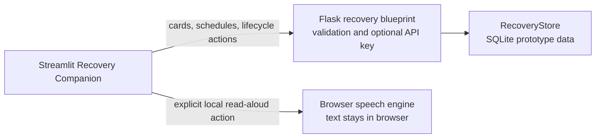

# Repository structure

```text
agents/                 Agent implementations, including experimental agents
core/                   Shared schemas and plugin abstractions
docs/                   Product and contributor documentation
integrations/
  oem/                  Vendor-neutral OEM adapter contract and future adapters
api/                    Recovery and device-session API blueprint
config/                 JSON application configuration
instance/               Local SQLite prototype data (git-ignored)
tests/                  Automated tests
ui/                     Streamlit developer console and Recovery Companion page
app.py                  Flask REST entry point
mcp_sse_server.py       FastAPI MCP/SSE entry point
mcp_agent_server.py     MCP stdio entry point
serve.py                Static browser simulator
```

## Boundaries

- Agent modules consume shared contracts from `core/`; they should not import OEM SDKs.
- OEM adapters normalize manufacturer-specific data into `core.schemas.TelemetryFrame`.
- The REST and MCP entry points remain at the repository root for compatibility with existing launch configurations and containers.
- The Streamlit UI is a separate optional process that calls the Flask REST API; it does not import agents or connect to wearable hardware directly.
- The Recovery Companion API is a separate Flask blueprint. It validates user-scoped requests and delegates persistence to `core.recovery.RecoveryStore`; the Streamlit page calls only these HTTP routes.
- The prototype store is local SQLite and unencrypted. Use synthetic content only. `API_KEY` is optional in local development and is a shared service key, not production user authentication. Setting `OCUGUARD_ENVIRONMENT=production` fails closed until per-user authentication, encrypted persistent storage, transport security, and operational controls are implemented.
- Device lifecycle is isolated behind `DeviceSessionAdapter`. The only implementation is a synthetic simulator; it reports no hardware connection, capture, or glasses output capability.
- Runtime limits and UI/device defaults are loaded from `config/app.json`, with documented environment overrides. Secrets belong in environment configuration, never the JSON file.
- [Spec.md](Spec.md) and [contributing.md](contributing.md) contain the longer-form specification and contribution guidance. The [wearable integration action plan](wearable-integration-action-plan.md) describes a gated path for future device work; [store readiness](store-readiness.md) tracks platform and listing preparation. The root `README.md` is the user-facing project overview.

There is no live manufacturer SDK integration in this repository. `integrations/oem/meta_glasses/` is a synthetic mapping example only. Add a real adapter only after an approved SDK, supported-device scope, consent flow, and privacy/security review are available.

## Recovery companion request flow



Instruction text is stored exactly as submitted and displayed with its user-entered source label. The API does not verify its source, summarize it, or create care instructions. Reminders use user-selected timestamps and timezones; due state is surfaced when the UI/API is used, with no background notification delivery or adherence monitoring. The browser read-aloud control uses the browser speech engine and is not glasses audio output; browser/OS speech processing may vary, so only synthetic text should be used.

The simulated device adapter supports session start, pause, resume, stop, and capability discovery for contract development. Session state is process-local, expires after the configured TTL, and cannot represent a real paired device. A production integration would need durable session ownership, real per-user authentication/authorization, transport security, encrypted storage, audit/retention controls, a vendor-approved SDK, and device-specific permission/output handling. This repository does not establish production or clinical readiness.
