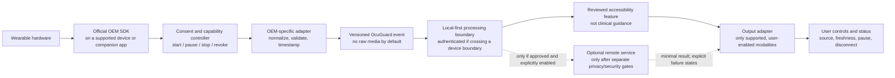

# Wearable Integration Action Plan

> **Status: proposed roadmap, not an implementation commitment.** OcuGuard currently has no live wearable connection or manufacturer SDK integration. The Meta-shaped adapter in this repository uses a synthetic OcuGuard-defined payload; it is not a Meta API contract, partnership, or compatibility claim.
>
> This plan is for technical discovery and a controlled software prototype. It is not legal, clinical, privacy, security, or regulatory advice, and it does not authorize patient-facing use.

> **Implementation status (2026-11):** the software P0/P1 prototype scope has been implemented, but the wearable roadmap below is not complete. The recovery companion can save user-entered instruction cards, present text in the browser, and maintain user-scheduled reminders. Its device lifecycle adapter is a simulator, not an OEM integration. Use synthetic data only; no production, clinical, Meta, or hardware-readiness claim is made.

### Implemented prototype scope

| Capability | Current implementation | Not yet established |
|---|---|---|
| Instruction cards | Create, edit, list, and delete user-entered text with a user-entered source label. Text is preserved as submitted. | The source is not verified; no care-team account, review, import, or clinician workflow exists. |
| Reminders | User-selected time/timezone; configurable one-time/daily/weekly intervals; pause, resume, snooze, acknowledge, and delete. | Due state is shown when the UI/API is used. There is no background notification delivery, delivery guarantee, or adherence monitoring. |
| Accessible presentation | Browser read-aloud with a stop control and visible text. | This is not glasses audio output or an accessibility validation result. Browser/OS speech processing may vary. |
| Device lifecycle | Start/pause/resume/stop and capability discovery through a synthetic, in-process adapter. | No Meta SDK, pairing, connection, capture, display/audio output, or durable session service exists. |
| Configuration and review prep | `config/app.json` controls feature flags, field/storage limits, reminder intervals, timezones, API defaults, and draft listing metadata. A store/developer-program checklist exists in `docs/store-readiness.md`. | Listing values and category are drafts; current program eligibility, official SDK terms, and store submission requirements remain unverified. |
| Data protection | Recovery data is scoped by a caller-provided demo ID and stored in local SQLite; data deletion is available. Production startup fails closed. | The database is unencrypted; demo IDs are not authenticated identities. The optional shared API key is not per-user authorization. |

These features are prototype foundations, not proof of product readiness. See the [architecture guide](architecture.md) and [store readiness checklist](store-readiness.md) for boundaries and release gates.

## Goal

Create a vendor-neutral path for a future wearable or companion-device integration while keeping manufacturer SDK code isolated, user-controlled, and replaceable. The first deliverable should prove connectivity, permissions, data quality, and failure handling with synthetic or non-sensitive data; it should not make clinical decisions.

## Recommendation

Treat wearable support as a **companion-app/device integration**, not as a Python server importing a glasses SDK. Many wearable SDKs are tied to a mobile OS, a specific device generation, developer enrollment, or vendor-controlled permissions. Confirm the current official SDK and supported-device scope before choosing the app platform or promising support.

Start with a read-only, user-initiated connection and capability check. If a real sensor is approved for the proof of concept, use one minimal signal and show its source, freshness, and availability without interpreting it as a medical finding. Keep camera, microphone, raw image, and raw audio capture out of the first prototype.

## Current-state review

| Area | Observed repository state | Consequence for wearable work |
|---|---|---|
| OEM boundary | `OEMTelemetryAdapter` maps a vendor-shaped frame to `TelemetryFrame`; `DeviceSessionAdapter` defines a separate lifecycle contract. | The session contract is currently backed by an in-process synthetic implementation; it does not manage a real SDK connection, permissions, streaming, or wearable outputs. |
| Meta example | `MetaGlassesExampleAdapter` maps an OcuGuard-defined synthetic object. The device-session demo does not import a Meta SDK or access a device. | Keep both as fixtures/examples. Do not treat their fields or capabilities as a Meta API contract. |
| Shared frame | `TelemetryFrame` requires `user_id` and `input_string`; several sensor fields default to `0.0`, and the model has no event timestamp, sequence, unit/source metadata, or explicit freshness state. | A missing measurement could be confused with a real zero. Define a versioned event contract before connecting sensors. |
| REST ingestion | `POST /v1/stream/evaluate` remains a request/response evaluation path. Separate recovery routes persist user-entered cards and schedules in local SQLite; device session routes exercise a synthetic lifecycle. | These additions are not a wearable stream protocol. Define production identity, authorization, replay/freshness, and storage before any remote connection. |
| Processing | The legacy evaluation API still routes to agent modes; the separate recovery API stores user-entered content without sending it to those agents. The Streamlit companion calls the recovery/device endpoints. | Keep recovery content separate from agent evaluation. Do not connect wearable capture or raw media to existing agent routes. |
| Persistence and UI output | Recovery cards/reminders use local SQLite; browser read-aloud is explicitly user-triggered. | SQLite is unencrypted; browser/OS speech handling varies; use synthetic text only. There is no background scheduler or device output. |
| Runtime safeguards | `API_KEY` can protect recovery/device routes with a shared key. `OCUGUARD_ENVIRONMENT=production` fails closed until key controls exist. Some legacy rate limiting remains process-local. | No per-user authentication/authorization, encrypted storage, transport/deployment controls, or operational release is implemented. Keep the prototype private. |

These are engineering observations, not claims that the current redaction, defaults, or disclaimers are adequate for real-world data.

## Proposed architecture

### Boundary rules

1. Manufacturer SDK imports, permissions, and lifecycle code belong in a device-specific package or companion application. Agent modules and shared schemas must not import an OEM SDK.
2. Keep raw camera, microphone, and image/audio data on the device unless a separately approved feature requires transfer. The default wearable proof of concept does not capture or transmit them.
3. Normalize only the minimum fields required by a reviewed use case. Preserve the source, unit, observation time, sequence, and quality/freshness metadata needed to interpret a reading.
4. Treat an absent, invalid, stale, permission-denied, or disconnected sensor as **unavailable**, not as a neutral value, safe status, or successful evaluation.
5. Separate sensor ingestion from agent evaluation and from device output. A connection event must not automatically trigger a patient-facing instruction.
6. Make permissions, capture state, network state, and any remote processing visible and user-controlled. Provide pause, stop, revoke, and data deletion behavior where data is retained.
7. Never put access tokens, vendor SDK objects, raw media, or direct personal identifiers in agent payloads, logs, analytics, or test fixtures.

## Delivery phases and exit gates

### Phase 0 - Product and platform discovery

**Status: open.** The app-store readiness document contains a draft listing, but no target Meta product path, official SDK access, supported device matrix, or eligibility decision has been recorded.

**Work**

- Select one user-validated, non-diagnostic accessibility task for a first technical prototype.
- Build a device/platform matrix: candidate glasses, companion OS, supported models, official SDK name/version, permissions, available sensor/output capabilities, regional and developer-program restrictions, and known limitations.
- Verify each item against current official OEM documentation and terms. Record the date and source; do not infer support from marketing pages or this example adapter.
- Decide whether the SDK must run in a separate native companion app/repository. Do not force a mobile SDK into the Python backend.

**Deliverable:** a scoped use-case brief and evidence-backed platform decision.

**Exit gate:** product and engineering owners agree on one target platform/device and one narrowly scoped experience. If SDK access, terms, or capability is uncertain, continue with the simulator only.

### Phase 1 - Data-flow, privacy, security, and safety design

**Status: partial.** The prototype documents its local SQLite and browser-speech data flows and blocks production startup. A full threat model, approved consent workflow, per-user identity, encrypted storage, and qualified review are still outstanding.

**Work**

- Draw the data-flow and trust-boundary diagram from sensor permission through processing, storage, output, logging, and deletion.
- Specify what data is collected, where it is processed, who can access it, whether any external model/provider is called, retention, and deletion behavior.
- Threat-model device pairing, credentials, replayed/stale frames, unauthorized control, logs, mobile-to-service traffic, and compromised SDK callbacks.
- Review the intended feature with accessibility participants. If it could affect care, mobility, post-operative behavior, emergency response, or other clinical decisions, stop and obtain qualified clinical, legal, privacy, and regulatory review before implementation or testing with patients.
- Establish an explicit consent/permission experience, user-visible capture indicator, pause/stop/revoke flow, and failure-state copy.

**Deliverable:** reviewed data map, threat model, consent/state flow, and written intended-use boundary.

**Exit gate:** no unresolved high-risk data flow or ambiguous clinical claim. No real patient or biometric data is used for development.

### Phase 2 - Versioned event and lifecycle contracts

**Status: partial.** A synthetic lifecycle contract exists for session state. The versioned wearable event envelope, sensor freshness/quality semantics, permission lifecycle, and output contract described below are not implemented.

**Work**

- Design a versioned, vendor-neutral wearable event envelope. At minimum, evaluate:
  - schema version and event type;
  - source platform/device and adapter/SDK version;
  - capture timestamp, monotonic sequence, and session identifier;
  - explicit units and coordinate conventions;
  - measured values plus quality/freshness/availability state;
  - capability and permission state needed to explain why a signal is or is not available.
- Use an opaque, short-lived session identifier rather than a real-world identity. Make text/input fields optional for sensor-only events.
- Replace ambiguous numeric defaults with explicit optional/availability values for live sensor fields. Do not use the existing `confidence=95.0` default as sensor quality or clinical confidence.
- Define separate contracts for:
  1. mapping one SDK event to a normalized event;
  2. opening/closing a device session and handling permission changes;
  3. delivering approved output to a wearable or companion UI.
- Specify validation for finite numbers, allowed units/ranges, stale/future timestamps, duplicate/out-of-order sequence values, and unsupported schema versions.

**Deliverable:** reviewed schema proposal and interface contract with migration/versioning notes.

**Exit gate:** API and mobile/device owners agree on missing-data semantics, timestamps, units, session lifecycle, and error responses.

### Phase 3 - Simulator and contract test harness

**Status: partial.** Hardware-free tests cover instruction/reminder APIs and the synthetic session lifecycle. They do not yet replay vendor-shaped sensor events or cover the full permission, stale/reordered event, and SDK-version fault matrix described below.

**Work**

- Extend the synthetic adapter fixture to represent connection, permission, available/unavailable sensors, stale/out-of-order events, disconnects, and unsupported capabilities.
- Build a hardware-free simulator that replays synthetic events through the exact normalizer and service contract intended for the device integration.
- Add contract tests proving that vendor-only fields and SDK objects do not leak across the adapter boundary.
- Confirm that malformed, missing, stale, and permission-denied inputs produce explicit unavailable/error states and never call an agent as if a valid neutral measurement was received.

**Deliverable:** deterministic offline simulator and adapter/API contract suite.

**Exit gate:** tests cover the normal path and the listed failure paths without network, credentials, or physical hardware.

### Phase 4 - First-device technical spike

**Status: blocked on Phase 0 and approved SDK access.** Do not implement or claim a Meta device connection based on the synthetic adapter.

**Work**

- Only after Phases 0-3 pass, create a small device-specific integration for the approved official SDK and one supported device/OS combination.
- Implement permission request, capability discovery, connect, pause, resume, stop, revoke, and disconnect handling.
- Begin with connection state and one explicitly approved non-sensitive signal, if available. Do not add continuous capture or upload of raw media.
- Map SDK events through the versioned normalizer. Keep the existing synthetic example and tests independent of the vendor package.
- Record compatibility and failure behavior for each tested device/OS/SDK combination.

**Deliverable:** isolated, opt-in, hardware-in-the-loop proof of concept with no patient-facing recommendations.

**Exit gate:** permissions can be revoked; stale/disconnected data is rejected; the app visibly reports unavailable states; and no raw media or secrets appear in network traffic, logs, or stored test output.

### Phase 5 - User-controlled output and accessibility evaluation

**Status: partial.** Browser speech is user-triggered and interruptible. It is not a wearable output adapter and has not undergone accessibility or usability evaluation.

**Work**

- Define an output adapter for the actual capabilities approved by the target device: companion screen, glasses display, audio, or other supported modality. Do not assume the device supports any particular output API.
- Make all output user-enabled and interruptible. Avoid autonomous warnings that could be mistaken for clinical or emergency alerts.
- Evaluate readability, audio accessibility, privacy in shared spaces, comfort, battery impact, latency, and error recovery with synthetic tasks and accessibility participants under an approved protocol.
- Set numeric performance targets only after the use case, hardware, and user needs are established; measure end-to-end latency, event loss, reconnect behavior, and battery impact.

**Deliverable:** accessible output prototype, test report, and prioritized usability findings.

**Exit gate:** users can understand the source and uncertainty of output, turn it off, and recover from unavailable-device/network conditions without misleading reassurance.

### Phase 6 - Private engineering pilot

**Status: not started.** The current local store and shared-key model do not meet the controls required for a pilot.

**Work**

- Run a limited, internal pilot with synthetic or non-sensitive data and an explicit device/OS/SDK support matrix.
- Add reviewed authentication and authorization for every remote endpoint, transport security, secret management, CORS policy if applicable, rate limiting/shared state, audit-safe telemetry, retention controls, and incident response.
- Test upgrades, revoked permissions, app backgrounding, reconnects, device replacement, battery loss, API timeouts, and offline operation.
- Keep deployments private. Confirm that deployment topology and replicas match the session and state model.

**Deliverable:** operational runbook, device compatibility matrix, threat-model updates, and pilot exit report.

**Exit gate:** security/privacy owners approve the environment for the explicitly scoped non-patient pilot. A private pilot is not product or clinical approval.

### Phase 7 - Separate patient-facing/product gate

**Status: not started and out of scope for this prototype.**

Do not treat a successful technical prototype as approval for patient use. Before any patient-facing claim, clinical workflow, or care-related feature, obtain the appropriate professional assessment for intended use, jurisdiction, evidence, human factors, accessibility, privacy, security, and regulatory obligations. Define a separate release plan only after these reviews establish what is permissible and what evidence is required.

## Remaining prioritized wearable backlog

The priority labels below are wearable-program prerequisites; they are separate from the already implemented software P0/P1 prototype scope above. Status means code/documentation progress only, not approval.

| ID | Priority | Action | Status | Owner role | Depends on | Acceptance evidence |
|---|---|---|---|---|---|---|
| WEAR-01 | P0 | Select one user-validated use case and target device/OS; verify official SDK access and terms. | Open | Product + OEM/platform lead | None | Decision record links current official sources and names unsupported assumptions. |
| WEAR-02 | P0 | Complete data-flow, consent, privacy, threat, and intended-use review. | Partial: prototype data flows documented; formal review open | Privacy/security + product | WEAR-01 | Review artifacts identify every capture, transfer, storage, external provider, and deletion path. |
| WEAR-03 | P0 | Define versioned event and device-session contracts; resolve missing/stale/quality semantics. | Partial: synthetic session lifecycle only | Architecture/API lead | WEAR-01, WEAR-02 | Schema review approves units, timestamps, sequence, availability, and failure behavior. |
| WEAR-04 | P1 | Complete simulator and hardware-free contract/fault tests. | Partial: recovery and synthetic session tests exist | QA + API lead | WEAR-03 | CI exercises invalid, stale, duplicate, permission-denied, disconnect, and unsupported-version cases. |
| WEAR-05 | P1 | Implement one isolated official-SDK adapter and permission lifecycle. | Blocked: no target SDK/device approval | Mobile/OEM lead | WEAR-01 through WEAR-04 | Authorized device test shows opt-in, pause/revoke, disconnect, and clean normalized events. |
| WEAR-06 | P1 | Implement and evaluate a user-controlled output adapter for one approved modality. | Partial: browser speech only; no glasses output or user study | Accessibility + client lead | WEAR-01, WEAR-02 | Output is interruptible, source-labeled, and tested for accessibility and failure states. |
| WEAR-07 | P1 | Establish security controls and private deployment runbook for device-connected paths. | Open: production startup is blocked | Security/platform | WEAR-02, WEAR-03 | Auth, secrets, transport, logs, retention, and replica/state behavior pass review. |
| WEAR-08 | P2 | Run the private engineering pilot and publish compatibility/limitations report. | Not started | QA + product + platform | WEAR-04 through WEAR-07 | Pilot report records device matrix, performance, failures, and explicit go/no-go decision. |
| WEAR-09 | P2 | Commission separate clinical/regulatory/product assessment if scope moves toward patient use. | Deferred; separate approval gate | Product + qualified advisers | WEAR-08 | Written decision defines permitted claims, evidence needs, and release gates. |

Priorities are sequence guidance, not calendar estimates. Do not start a later phase while a dependency or exit gate is unresolved.

## Test and validation strategy

The current prototype coverage includes `tests/test_recovery_companion_api.py`, `tests/test_recovery_companion_ui.py`, and `tests/test_application_config.py`. Passing those tests validates only the implemented software contracts; it does not validate an OEM SDK, hardware behavior, clinical use, or a store submission.

- **Unit:** field mapping, units, range validation, timestamp conversion, sequence handling, permission-state mapping, and redaction.
- **Contract:** vendor adapter output conforms to the versioned shared event; unknown vendor fields are dropped; SDK types and media objects do not cross the boundary.
- **Fault injection:** absent/denied/revoked permissions, unsupported capability, malformed values, stale/future timestamps, duplicate/reordered events, disconnection, process restart, and network loss.
- **Integration:** companion/device adapter to local ingestion to approved transformation to user-controlled output, with synthetic fixtures and mocked remote services.
- **Hardware-in-the-loop:** only authorized supported devices; record device model, OS, SDK version, and test conditions. Never make a test dependent on a production account or real personal data.
- **Privacy/security:** inspect network traffic and logs; verify no raw media, secrets, or direct identifiers leave the approved boundary; test authentication, authorization, replay handling, and deletion.
- **Accessibility/usability:** test setup, consent, status, pause/stop, output comprehension, and recovery with assistive technology and people with relevant lived experience under an approved process.
- **Release evidence:** test results and limitations are published; no clinical-efficacy claim is made from connectivity or usability testing.

## Decisions to record before implementation

1. Which specific user task is the first target, and which tasks are explicitly out of scope?
2. Which device models, companion OS versions, SDK versions, regions, and developer agreements are supported?
3. Does the SDK run on-device, in a phone companion app, or through another supported bridge?
4. Which sensor/output capabilities are truly required? Can the first milestone avoid camera, microphone, and cloud services?
5. What data remains local, what can leave the device, who can access it, and how long is it retained?
6. What is the permitted output behavior, and what must happen when a reading is uncertain or unavailable?
7. Which qualified reviewers and accessibility participants approve each gate?

## Non-goals for the first integration

- Claiming Meta or another OEM compatibility, partnership, endorsement, or supported device without verified official evidence.
- Capturing continuous camera or microphone streams or sending raw media to the backend.
- Diagnosing, triaging, treating, providing post-operative positioning, or making emergency/safety decisions.
- Reusing a simulator threshold as a validated patient threshold.
- Exposing the current API or MCP service publicly with wearable or health data.
- Treating a disclaimer, prototype label, or open-source license as regulatory or legal clearance.
